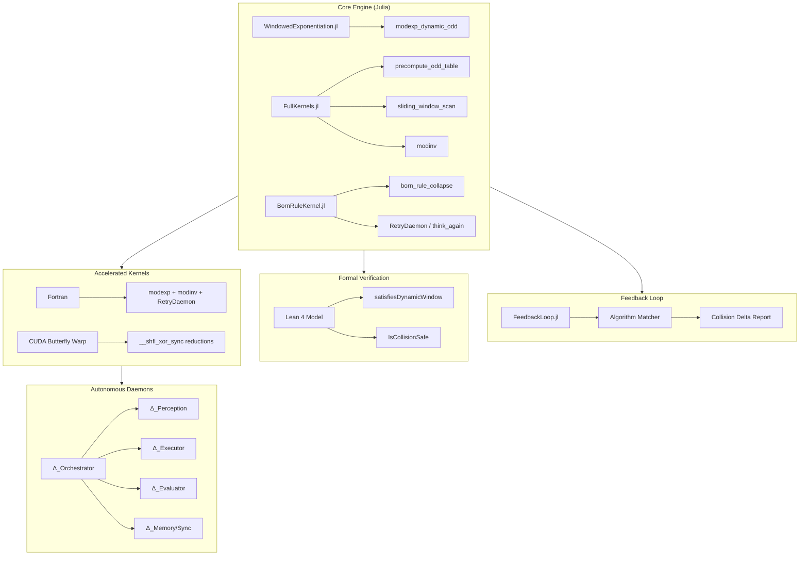

# Sovereign Algorithm Engine

[](https://julialang.org)
[](https://leanprover.github.io)
[](https://developer.nvidia.com/cuda-toolkit)
[](LICENSE)

A verified, multi-language modular-exponentiation engine with dynamic-window odd-table algorithms, modular inversion, Quantum Born Rule skill collapse, and an Autonomous Feedback Loop Daemon Architecture.

> **Core invariants**  
> Dynamic window: \(2^{w-1} < n \le 2^w\)  
> Odd-only table: \(2^{w-1}\) entries, index \((v-1)/2\)  
> Lean 4 safety model: no `sorry`, `propext` only.

---

## Architecture Overview



---

## Algorithms Showcase

### 1. Dynamic-Window Odd-Table Modular Exponentiation

| Property | Value |
|----------|-------|
| Window sizing | \(w = \lceil\log_2 n\rceil\) (exact integer) |
| Table size | \(2^{w-1}\) odd multiples only |
| Indexing | \((v-1)/2\) |
| Scan | Sliding window from MSB, every window ends in 1 |

**Implementations**
- Julia: `modexp_dynamic_odd`, `modexp_limbs`
- Fortran: `kernels/fortran/modexp_dynamic_odd.f90`
- CUDA: `kernels/cuda/butterfly_warp_modexp.cu` (warp butterfly reductions)

### 2. Modular Inversion (Binary Extended Euclidean)

Returns \(a\) such that \(a \cdot x \equiv 1 \pmod{m}\), or fails if not invertible.

- Julia / Fortran / CUDA implementations present.

### 3. Quantum Born Rule Skill Collapse

Models a 1,000-skill library as a normalized amplitude vector \(\lvert\psi\rangle = \sum c_i \lvert\phi_i\rangle\).

\[
P(i) = \lvert c_i\rvert^2
\]

- `born_rule_collapse` — inverse-transform sampling
- `update_amplitudes` — reward reinforcement + renormalization
- `RetryDaemon.think_again` — golden-ratio moduli shift + phase modulation + fresh collapse

### 4. Autonomous Feedback Loop Daemon Architecture

Five specialized daemons (Orchestrator, Perception, Executor, Evaluator, Memory/Sync) that continuously monitor, evaluate, and adapt. Full specification in `kernels/architecture/AutonomousDaemonArchitecture.md`.

---

## Quick Start

```bash
# Clone and run the Julia test suite (52/52)
git clone https://github.com/AHMADALIPARR/sovereign-algorithm-engine
cd sovereign-algorithm-engine
julia test/runtests.jl

# Feedback report demo
julia src/FeedbackLoop.jl
```

### Kernel Drivers

```bash
# Julia
julia -e 'using .SovereignAlgorithmEngine; println(modexp_limbs(5, 13, 100; size_hint=4)); println(modinv(3, 7))'

# Fortran
gfortran -o test_modexp kernels/fortran/modexp_dynamic_odd.f90 && ./test_modexp
gfortran -o test_modinv kernels/fortran/modinv.f90 && ./test_modinv
gfortran -o test_retry kernels/fortran/retry_daemon.f90 && ./test_retry

# CUDA (sm_70+)
nvcc -o butterfly_modexp kernels/cuda/butterfly_warp_modexp.cu -arch=sm_70 && ./butterfly_modexp
nvcc -o modinv kernels/cuda/modinv.cu -arch=sm_70 && ./modinv
```

---

## Benchmarks

Micro-benchmarks live in `benchmarks/`. They measure wall-clock time on small fixed vectors and are intended for regression tracking.

| Kernel | Language | Operation | Notes |
|--------|----------|-----------|-------|
| `modexp_limbs` | Julia | 5^13 mod 100 | BenchmarkTools |
| `modinv` | Julia | inv(3) mod 7 | BenchmarkTools |
| `born_rule_collapse` | Julia | 1000-skill sample | BenchmarkTools |
| `modexp` | Fortran | 5^13 mod 100 | `cpu_time` |
| `modinv` | Fortran | inv(3) mod 7 | `cpu_time` |
| butterfly modexp | CUDA | 5^13 mod 100 | CUDA events |
| modinv | CUDA | inv(3) mod 7 | CUDA events |

```bash
# Run all
julia -e 'using Pkg; Pkg.add("BenchmarkTools")'
julia benchmarks/julia_bench.jl

gfortran -O3 -o fortran_bench benchmarks/fortran_bench.f90 \
  kernels/fortran/modexp_dynamic_odd.f90 kernels/fortran/modinv.f90
./fortran_bench

nvcc -O3 -o cuda_bench benchmarks/cuda_bench.cu \
  kernels/cuda/butterfly_warp_modexp.cu kernels/cuda/modinv.cu -arch=sm_70
./cuda_bench
```

> Results are machine-dependent. Record local timings in `STATUS.md` if desired. No absolute performance claims are made.

---

## Verification

The Lean 4 model (`lean/SovereignAlgorithmEngine.lean`) proves:

- Dynamic-window invariant \(2^{w-1} < n \le 2^w\)
- Collision-safety of the adaptive odd-table construction
- Feedback-loop transition preserves safety

```
#print axioms  →  [propext] only
```

See `STATUS.md` for the full verification record and toolchain notes.

---

## Repository Layout

```
src/
  WindowedExponentiation.jl    # core dynamic-window odd-table modexp
  FullKernels.jl               # separated kernels + modinv
  BornRuleKernel.jl            # Born collapse + RetryDaemon
  FeedbackLoop.jl              # structural matcher + collision delta
lean/
  SovereignAlgorithmEngine.lean
kernels/
  architecture/                # daemon architecture specification
  fortran/                     # modexp, modinv, RetryDaemon
  cuda/                        # butterfly-warp modexp, modinv
benchmarks/                    # Julia / Fortran / CUDA harnesses
test/runtests.jl               # 52/52 suite
```

---

## License

See [LICENSE](LICENSE).

---

*Built with formal verification in mind. The engine decides; the sandbox executes.*
